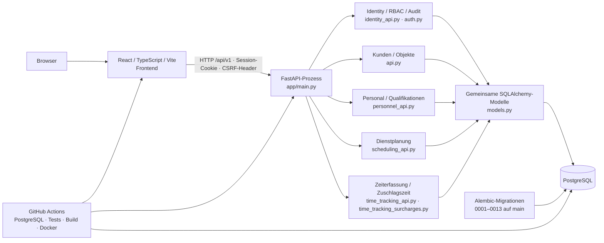

# Architektur

## Ist-Architektur auf `main`

SecurityOps ist ein modular gedachter, derzeit noch zentral organisierter Monolith. Die API-Router sind nach fachlichen Dateien getrennt, die SQLAlchemy-Modelle liegen jedoch gemeinsam in `backend/app/models.py`, und das Frontend ist eine gemeinsame React-Anwendung ohne eigenständige Modul-Bundles. PostgreSQL ist die Betriebsdatenbank; Alembic verwaltet Schemaänderungen. Docker Compose ist für lokale Entwicklung ausgelegt.

## Request- und Berechtigungsfluss

`main.py` registriert Router aus `api.py`, `personnel_api.py`, `scheduling_api.py`, `time_tracking_api.py`, `time_tracking_surcharges.py` und `identity_api.py` unter `/api/v1`; die Health-Endpunkte liegen außerhalb des Präfixes. Authentifizierte Requests lesen ein zufälliges opaque Session-Cookie. Gespeichert wird der Hash des Session-Tokens; Berechtigungen werden aus Benutzerrollen und Rollenrechten serverseitig ermittelt. Für zustandsändernde authentifizierte Requests müssen CSRF-Cookie und `X-CSRF-Token` übereinstimmen und der gespeicherte Tokenhash passen. Objekt-/Personal-Scope ist zusätzlich zu Modulrechten relevant. Frontend-Sichtbarkeit ist keine Sicherheitsgrenze.

`/health/live` prüft nur den Prozess. `/health/ready` versucht eine Datenbankabfrage und liefert bei nicht verfügbarer Datenbank HTTP 503. CORS wird aus `CORS_ORIGINS` geladen. Ein allgemeines Security-Header-/TLS-Middleware-Setup ist nicht vorhanden.

## Daten- und Integritätsgrenzen

Geschäftsdaten und Benutzerrechte liegen in PostgreSQL. Die fachlichen Tabellen, Beziehungen und Constraints stehen in [`DATABASE.md`](DATABASE.md). Migrationen sind eine lineare Alembic-Kette bis Revision `0013_time_tracking_surcharges` auf `main`. PR #23 schlägt `0014_owks_wachbuch` vor und PR #24 darauf aufbauend `0015_documents_contracts`; beide sind offen und nicht Teil des Diagramm-/Ist-Standes.

Mehrere Datenbereiche haben separate sensitive Tabellen und Endpunkte. Qualifikationsdateien werden derzeit in der Datenbank gespeichert. Ein KMS-/Schlüsselrotationssystem, Malware-Prüfung und externe private Dateiablage sind nicht vorhanden. Für Planungs- und Zeiterfassungsoperationen bestehen Datenbankconstraints und PostgreSQL-Advisory-Locks; dies wird in der Detaildokumentation beschrieben.

## Lokale Entwicklung und CI

Compose startet PostgreSQL 17, API und Vite-Devserver. Der API-Container führt Migrationen bei Start aus. Das ist kein koordinierter Release-Migrationsschritt für mehrere Replikate. CI führt Migrationen einmal auf temporärem PostgreSQL 17 aus, dann Backendtests; zusätzlich prüft sie Ruff, `npm run build`, `npm test` und baut beide Container-Images. CI-Erfolg belegt keine Produktionsfähigkeit.

## Nicht im aktuellen `main`

OWKS befindet sich in PR #23, Dokumenten-/Vertragsfunktionen in davon abhängigem PR #24. Beide umfassen unter anderem noch nicht gemergten Quellcode und eigene Migrationen; sie dürfen nicht als bestehende Laufzeitkomponenten dargestellt werden. Rechnungswesen ist nicht implementiert. Eine verteilte Modul-/Servicearchitektur ist nicht vorhanden und auch nicht vorausgesetzt.
