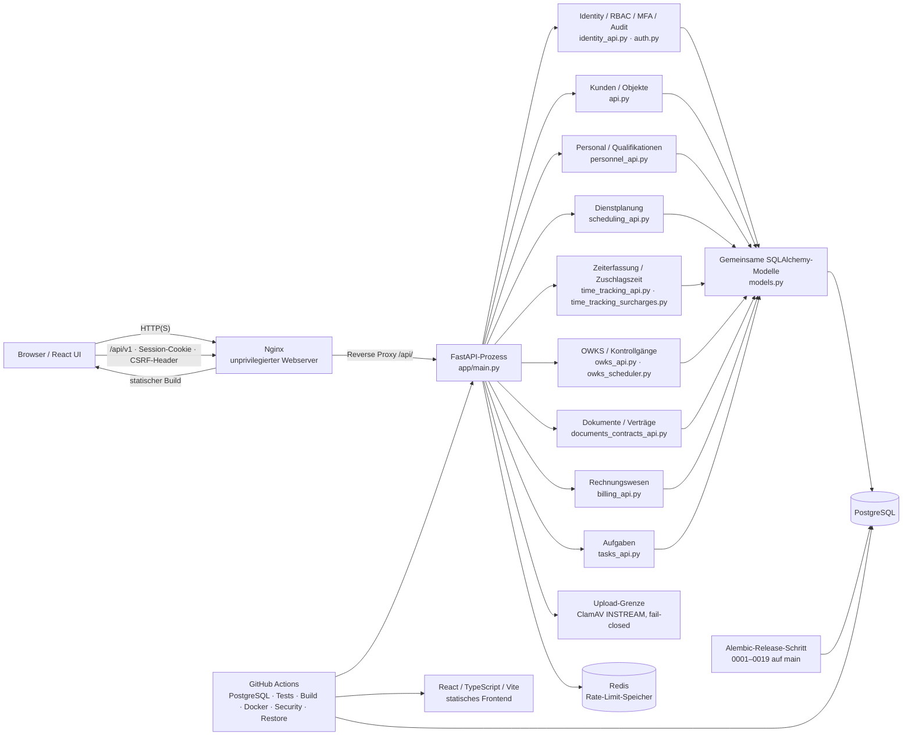

# Architektur

## Ist-Architektur auf `main`

SecurityOps ist ein modular gedachter, derzeit noch zentral organisierter Monolith. Die API-Router sind nach fachlichen Dateien getrennt, die SQLAlchemy-Modelle liegen jedoch gemeinsam in `backend/app/models.py`, und das Frontend ist eine gemeinsame React-Anwendung ohne eigenständige Modul-Bundles. PostgreSQL ist die Betriebsdatenbank; Alembic verwaltet Schemaänderungen. Docker Compose umfasst ein Produktionssetup und ein getrenntes Entwicklungs-Override.

## Request- und Berechtigungsfluss

`main.py` registriert Router aus `api.py`, `personnel_api.py`, `scheduling_api.py`, `time_tracking_api.py`, `time_tracking_surcharges.py`, `documents_contracts_api.py`, `billing_api.py`, `identity_api.py` und `owks_api.py` unter `/api/v1`; die Health-Endpunkte liegen außerhalb des Präfixes. Authentifizierte Requests lesen ein zufälliges opaque Session-Cookie. Gespeichert wird der Hash des Session-Tokens; Berechtigungen werden aus Benutzerrollen und Rollenrechten serverseitig ermittelt. MFA per TOTP ist optional aktivierbar; Recovery-Codes sind einmalig und gehasht, MFA-Secrets verschlüsselt. Sitzungen können durch den Kontoinhaber oder berechtigte Administratoren eingesehen bzw. widerrufen werden. Für zustandsändernde authentifizierte Requests müssen CSRF-Cookie und `X-CSRF-Token` übereinstimmen und der gespeicherte Tokenhash passen. Objekt-/Personal-Scope ist zusätzlich zu Modulrechten relevant; Mitarbeiter-Objektzuweisungen werden gegen den Objektzugriff geprüft. Frontend-Sichtbarkeit ist keine Sicherheitsgrenze.

`/health/live` prüft nur den Prozess. `/health/ready` prüft Datenbank und in Produktion Redis und liefert bei Nichtverfügbarkeit HTTP 503. Das Produktions-Compose-Setup liefert statische Frontenddateien über Nginx; TLS wird von einem separat zu betreibenden Reverse Proxy terminiert. Nginx setzt Security-Header. Der API-Prozess nutzt in Produktion Redis für gemeinsam geteilte Rate-Limit-Zähler; Proxy-Header werden nur von konfigurierten vertrauenswürdigen Hops übernommen.

## Daten- und Integritätsgrenzen

Geschäftsdaten und Benutzerrechte liegen in PostgreSQL. Die fachlichen Tabellen, Beziehungen und Constraints stehen in [`DATABASE.md`](DATABASE.md). Migrationen sind eine lineare Alembic-Kette bis Revision `0019_tasks` auf `main`; das Schema umfasst 63 SQLAlchemy-Tabellen. Revision `0014_owks_wachbuch` ergänzt OWKS, `0015_documents_contracts` Dokumente und Verträge, `0016_scheduling_availability` Mitarbeiter-Verfügbarkeiten und Dienstwünsche, `0017_billing` Rechnungen/Positionen/Zahlungen/Exporte, `0018_identity_security` MFA, Recovery-Codes sowie Sitzungs-/Passwortverwaltungsfelder und `0019_tasks` den generischen Aufgaben-Kern. PRs #23, #24, #26, #27, #31 und #34 sind gemergt.

Mehrere Datenbereiche haben separate sensitive Tabellen und Endpunkte. Qualifikationsdateien und OWKS-Anhänge werden in PostgreSQL gespeichert; allgemeine Dokumentversionen liegen in einem konfigurierten privaten lokalen Dateispeicher und werden über geschützte Endpunkte gelesen. Neue Uploads in diesen drei Bereichen werden vor Speicherung synchron durch ClamAV geprüft; Scannerfehler, Timeout und Nichterreichbarkeit führen zur Ablehnung. Vorhandene Dateien werden nicht rückwirkend geprüft. Das ist keine Garantie vollständiger Erkennung oder Produktionssicherheit. Billing-Rechnungen speichern Kunden-/Eingabe-Snapshots, und Korrekturen erzeugen Folgebelege statt Originalrechnungen zu überschreiben. Geldwerte verwenden `Decimal`/`NUMERIC`; Steuerwerte bleiben Konfiguration und sind nicht fachlich oder steuerlich abgenommen. Ein externer Datei-/Objektspeicher, KMS/Schlüsselrotation sind nicht vorhanden. Für Planungs- und Zeiterfassungsoperationen bestehen Datenbankconstraints und PostgreSQL-Advisory-Locks; OWKS nutzt zusätzlich einen Hintergrundmonitor und Advisory-Locks. Der Aufgaben-Kern protokolliert Änderungen und Kommentare transaktional, ist aber nicht automatisch mit Fachereignissen gekoppelt. Details stehen in der Datenbank-, API- und Sicherheitsdokumentation.

## Deployment und CI

Das Produktions-Compose-Setup startet PostgreSQL, Redis, einen separaten einmaligen Alembic-Release-Schritt, API und Nginx für statische Frontenddateien. Ein separates Compose-Override stellt den lokalen Vite-Entwicklungsserver und HTTP-spezifische Einstellungen bereit. GitHub Actions prüft Backend und Migrationen auf PostgreSQL, Frontend-Build/Tests, Containerimages, Sicherheitsanalyse und einen isolierten synthetischen Backup-/Restorelauf. CI-Erfolg belegt weder reale Betriebsfähigkeit noch Produktionsfreigabe.

## Modulgrenzen und offene Arbeit

OWKS-Wachbuch, Dokumenten-/Vertragsfunktionen, Dienstplan-Verfügbarkeiten, Rechnungswesen, MFA/Sitzungsverwaltung, ClamAV-Uploadscan und Aufgaben-Kern sind in `main` integriert. Offene PR #25 betrifft ausschließlich Dokumentation. Issues #7–#10 bleiben offen; ihre offenen Akzeptanz-/Betriebsfragen bedeuten nicht, dass die zugehörigen gemergten Funktionen fehlen. Die Task-Funktion ist generisch und besitzt keine automatische Modul-Kopplung. MFA ist optional; es gibt keinen nutzerinitiierten E-Mail-Passwortreset. Ein administrativer Reset verlangt Passwortwechsel und widerruft Sessions. Der modulare Monolith ist nicht in getrennte Services aufgeteilt und das ist keine stillschweigende Zielanforderung.
