# Datenbank und Migrationen

## Quelle und Stand

Diese Referenz beschreibt den Quellcode auf `main` (`5f3530463e9531c1f825f43ae4c6a6e60b9974e3`), insbesondere `backend/app/models.py` und `backend/migrations/versions/`. Die Tabellen-/Spaltenlisten sind aus den SQLAlchemy-Metadaten abgeleitet, die Migrationshistorie aus den Alembic-Dateien. Der tatsächliche Laufzeit-Schema-Head ist `0013_time_tracking_surcharges`. Die vorgeschlagenen Tabellen/Migrationen `0014_owks_wachbuch` (PR #23) und `0015_documents_contracts` (PR #24) gehören nicht zu `main` und sind hier nicht als vorhandenes Schema verzeichnet.

UUID-Primärschlüssel werden in PostgreSQL als UUID geführt. Datums-/Zeitpunktfelder mit `DateTime(timezone=True)` werden als zeitzonenbewusste Zeitpunkte (`TIMESTAMPTZ`) abgebildet; APIs normalisieren Zeitpunkte für operative Zeitdaten nach UTC. JSON-Spalten und Binärdaten verwenden PostgreSQL-JSON bzw. `BYTEA`. Nicht aufgeführte `CHECK`-Regeln können zusätzlich in Schemas/Service-Code validiert werden; hier werden Datenbankconstraints und -indizes dokumentiert.

## Tabellenkatalog

`PK` steht für Primärschlüssel. Die Spaltenlisten nennen sämtliche Modellspalten; alle Spalten einer Tabelle sind aufgeführt. Die nullable Felder sind separat vollständig aufgeführt. UUID- und Zeittypabbildungen folgen den Typen in `models.py`; `created_at`/`updated_at`-Zeitpunkte sind, sofern vorhanden, zeitzonenbewusst.

| Tabelle | Spalten und Primärschlüssel |
|---|---|
| `customers` | PK `id`; `customer_number`, `company_name`, `status`, `email`, `phone`, `legal_form`, `website`, `contract_status`, `vat_number`, `tax_number`, `internal_notes`, `archived_at`, `created_at`, `updated_at` |
| `customer_addresses` | PK `id`; `customer_id`, `kind`, `street`, `house_number`, `postal_code`, `city`, `country_code` |
| `customer_contacts` | PK `id`; `customer_id`, `first_name`, `last_name`, `responsibility`, `email`, `phone`, `is_primary` |
| `customer_history` | PK `id`; `customer_id`, `actor_id`, `action`, `changed_fields`, `created_at` |
| `objects` | PK `id`; `customer_id`, `code`, `name`, `object_type`, `description`, `status`, `operating_hours`, `service_times`, `staffing_requirements`, `archived_at`, `created_at`, `updated_at` |
| `object_addresses` | PK `id`; `object_id`, `street`, `house_number`, `postal_code`, `city`, `country_code` |
| `object_contacts` | PK `id`; `object_id`, `first_name`, `last_name`, `role`, `email`, `phone`, `is_primary` |
| `object_history` | PK `id`; `object_id`, `actor_id`, `action`, `changed_fields`, `created_at` |
| `object_assignments` | PK `id`; `object_id`, `user_id`, `assigned_by_id`, `assigned_at` |
| `object_security_details` | PK/FK `object_id`; `security_requirements`, `access_information`, `emergency_contact`, `updated_at` |
| `employees` | PK `id`; `employee_number`, `user_id`, `full_name`, `email`, `phone`, `job_title`, `employment_status`, `hired_on`, `ended_on`, `contract_type`, `weekly_hours`, `archived_at`, `created_at`, `updated_at` |
| `employee_qualifications` | PK `id`; `employee_id`, `category`, `name`, `issuer`, `valid_from`, `expires_on`, `archived_at`, `created_at`, `updated_at` |
| `employee_qualification_documents` | PK `id`; `qualification_id`, `version`, `file_name`, `media_type`, `size_bytes`, `sha256`, `content`, `uploaded_by_id`, `created_at` |
| `employee_absences` | PK `id`; `employee_id`, `absence_type`, `starts_on`, `ends_on`, `status`, `created_by_id`, `created_at`, `updated_at` |
| `employee_sensitive_details` | PK/FK `employee_id`; `address`, `emergency_contact`, `internal_notes`, `updated_at` |
| `employee_history` | PK `id`; `employee_id`, `actor_id`, `action`, `changed_fields`, `created_at` |
| `employee_object_assignment_history` | PK `id`; `employee_id`, `object_id`, `user_id`, `actor_id`, `action`, `created_at` |
| `schedule_settings` | PK `id` (Singleton); `time_zone`, `minimum_rest_hours`, `updated_by_id`, `updated_at` |
| `schedule_shifts` | PK `id`; `employee_id`, `object_id`, `starts_at`, `ends_at`, `break_minutes`, `required_qualification`, `status`, `created_by_id`, `created_at`, `updated_at` |
| `schedule_shift_history` | PK `id`; `shift_id`, `actor_id`, `action`, `changed_fields`, `created_at` |
| `time_entries` | PK `id`; `employee_id`, `object_id`, `shift_id`, `started_at`, `ended_at`, `status`, `created_by_id`, `submitted_at`, `reviewed_by_id`, `reviewed_at`, `decision_reason`, `created_at`, `updated_at` |
| `time_entry_segments` | PK `id`; `entry_id`, `position`, `kind`, `started_at`, `ended_at` |
| `time_entry_corrections` | PK `id`; `entry_id`, `requested_by_id`, `reason`, `previous_status`, `status`, `rejection_reason`, `decided_by_id`, `requested_at`, `decided_at` |
| `time_entry_correction_segments` | PK `id`; `correction_id`, `position`, `kind`, `started_at`, `ended_at` |
| `time_entry_history` | PK `id`; `entry_id`, `actor_id`, `action`, `details`, `created_at` |
| `time_tracking_settings` | PK `id` (Singleton); `federal_state`, `updated_by_id`, `updated_at` |
| `time_surcharge_rules` | PK `id`; `code`, `name`, `category`, `calculation_type`, `value`, `currency`, `basis_description`, `valid_from`, `valid_to`, `priority`, `combination_mode`, `weekdays`, `starts_local`, `ends_local`, `created_by_id`, `created_at` |
| `time_surcharge_calculations` | PK `id`; `entry_id`, `version`, `gross_work_seconds`, `time_zone`, `federal_state`, `rule_snapshot`, `allocation_snapshot`, `source_segments`, `created_by_id`, `created_at` |
| `time_tracking_periods` | PK `id`; `from_date`, `to_date`, `time_zone`, `federal_state`, `locked_by_id`, `locked_at` |
| `users` | PK `id`; `username`, `email`, `full_name`, `password_hash`, `is_active`, `created_at`, `updated_at` |
| `roles` | PK `id`; `code`, `name`, `description` |
| `permissions` | PK `id`; `code`, `description` |
| `user_roles` | zusammengesetzter PK (`user_id`, `role_id`) |
| `role_permissions` | zusammengesetzter PK (`role_id`, `permission_id`) |
| `user_sessions` | PK `id`; `user_id`, `token_hash`, `csrf_token_hash`, `created_at`, `last_seen_at`, `expires_at`, `absolute_expires_at` |
| `audit_logs` | PK `id`; `actor_id`, `action`, `entity_type`, `entity_id`, `ip_address`, `details`, `created_at` |

### Nullable Spalten

Alle nicht in dieser Liste enthaltenen Spalten sind in den Modellen `nullable=False` bzw. Teil eines nicht-nullbaren Schlüssels.

| Tabelle | Nullable Spalten |
|---|---|
| `customers` | `email`, `phone`, `legal_form`, `website`, `vat_number`, `tax_number`, `internal_notes`, `archived_at` |
| `customer_contacts` | `responsibility`, `email`, `phone` |
| `customer_history` | `actor_id` |
| `objects` | `object_type`, `description`, `operating_hours`, `service_times`, `staffing_requirements`, `archived_at` |
| `object_contacts` | `role`, `email`, `phone` |
| `object_history` | `actor_id` |
| `object_assignments` | `assigned_by_id` |
| `object_security_details` | `security_requirements`, `access_information`, `emergency_contact` |
| `employees` | `user_id`, `email`, `phone`, `job_title`, `ended_on`, `contract_type`, `weekly_hours`, `archived_at` |
| `employee_qualifications` | `issuer`, `valid_from`, `expires_on`, `archived_at` |
| `employee_qualification_documents` | `uploaded_by_id` |
| `employee_absences` | `created_by_id` |
| `employee_sensitive_details` | `address`, `emergency_contact`, `internal_notes` |
| `employee_history` | `actor_id` |
| `employee_object_assignment_history` | `user_id`, `actor_id` |
| `schedule_settings` | `updated_by_id` |
| `schedule_shifts` | `required_qualification`, `created_by_id` |
| `schedule_shift_history` | `actor_id` |
| `time_entries` | `shift_id`, `ended_at`, `created_by_id`, `submitted_at`, `reviewed_by_id`, `reviewed_at`, `decision_reason` |
| `time_entry_segments` | `ended_at` |
| `time_entry_corrections` | `requested_by_id`, `rejection_reason`, `decided_by_id`, `decided_at` |
| `time_entry_history` | `actor_id` |
| `time_tracking_settings` | `federal_state`, `updated_by_id` |
| `time_surcharge_rules` | `currency`, `valid_to`, `starts_local`, `ends_local`, `created_by_id` |
| `time_surcharge_calculations` | `federal_state`, `created_by_id` |
| `time_tracking_periods` | `federal_state`, `locked_by_id` |
| `audit_logs` | `actor_id`, `entity_id`, `ip_address` |

## Fremdschlüssel und Löschverhalten

| Von (Spalte) | Nach | `ON DELETE` |
|---|---|---|
| `customer_addresses.customer_id`, `customer_contacts.customer_id`, `customer_history.customer_id`, `objects.customer_id` | `customers.id` | `RESTRICT` |
| `customer_history.actor_id`, `object_history.actor_id`, `object_assignments.assigned_by_id`, `employee_absences.created_by_id`, `employee_history.actor_id`, `employee_object_assignment_history.user_id`, `employee_object_assignment_history.actor_id`, `employee_qualification_documents.uploaded_by_id`, `schedule_settings.updated_by_id`, `schedule_shifts.created_by_id`, `schedule_shift_history.actor_id`, `time_entries.created_by_id`, `time_entries.reviewed_by_id`, `time_entry_corrections.requested_by_id`, `time_entry_corrections.decided_by_id`, `time_entry_history.actor_id`, `time_tracking_settings.updated_by_id`, `time_surcharge_rules.created_by_id`, `time_surcharge_calculations.created_by_id`, `time_tracking_periods.locked_by_id`, `audit_logs.actor_id` | jeweils `users.id` | `SET NULL` |
| `object_addresses.object_id`, `object_contacts.object_id`, `object_history.object_id`, `object_assignments.object_id`, `object_security_details.object_id`, `employee_object_assignment_history.object_id`, `schedule_shifts.object_id`, `time_entries.object_id` | `objects.id` | `RESTRICT` |
| `object_assignments.user_id` | `users.id` | `RESTRICT` |
| `employees.user_id` | `users.id` | `SET NULL`; eindeutig, nullable |
| `employee_qualifications.employee_id`, `employee_absences.employee_id`, `employee_sensitive_details.employee_id`, `employee_history.employee_id`, `employee_object_assignment_history.employee_id`, `schedule_shifts.employee_id`, `time_entries.employee_id` | `employees.id` | `RESTRICT` |
| `employee_qualification_documents.qualification_id` | `employee_qualifications.id` | `RESTRICT` |
| `schedule_shift_history.shift_id` | `schedule_shifts.id` | `RESTRICT` |
| `time_entries.shift_id` | `schedule_shifts.id` | `RESTRICT` |
| `time_entry_segments.entry_id`, `time_entry_corrections.entry_id`, `time_entry_history.entry_id`, `time_surcharge_calculations.entry_id` | `time_entries.id` | `RESTRICT` |
| `time_entry_correction_segments.correction_id` | `time_entry_corrections.id` | `RESTRICT` |
| `user_sessions.user_id` | `users.id` | `CASCADE` |
| `user_roles.user_id`, `user_roles.role_id` | `users.id`, `roles.id` | jeweils `CASCADE` |
| `role_permissions.role_id`, `role_permissions.permission_id` | `roles.id`, `permissions.id` | jeweils `CASCADE` |

## Constraints und Indizes

Primärschlüssel sind in der Tabellenübersicht aufgeführt. Die folgenden benannten `CHECK`-/`UNIQUE`-Constraints und zusätzlichen Indizes stammen aus Modellen und Migrationen; die partiellen Bedingungen sind angegeben.

| Tabelle | Constraints / Indizes |
|---|---|
| `customers` | Checks `ck_customers_status` (`active/inactive/lead`), `ck_customers_contract_status` (`none/draft/active/expired/terminated`), `ck_customers_company_name`; Indizes `ix_customers_customer_number` (unique), `ix_customers_company_name`, `ix_customers_status` |
| `customer_addresses` | Unique `uq_customer_addresses_customer_kind`; Checks `ck_customer_addresses_kind`, `ck_customer_addresses_required_fields` |
| `customer_contacts` | Check `ck_customer_contacts_name`; Index `ix_customer_contacts_customer_name`; partieller Unique-Index `uq_customer_contacts_primary(customer_id)` für primäre Kontakte (`is_primary`) |
| `customer_history` | Index `ix_customer_history_customer_created` |
| `objects` | Checks `ck_objects_status`, `ck_objects_name`, `ck_objects_code`; Indizes `ix_objects_code` (unique), `ix_objects_name`, `ix_objects_customer_status` |
| `object_addresses` | Unique `uq_object_addresses_object`; Check `ck_object_addresses_required_fields` |
| `object_contacts` | Check `ck_object_contacts_name`; Index `ix_object_contacts_object_name`; partieller Unique-Index `uq_object_contacts_primary(object_id)` für `is_primary` |
| `object_history` | Index `ix_object_history_object_created` |
| `object_assignments` | Unique `uq_object_assignments_object_user`; Index `ix_object_assignments_user_object` |
| `object_security_details` | Checks `ck_object_security_requirements_nonblank`, `ck_object_access_information_nonblank` |
| `users` | Unique-Indizes `ix_users_username`, `ix_users_email`; Checks `ck_users_username`, `ck_users_full_name` |
| `roles`, `permissions` | jeweils `code` unique |
| `user_sessions` | `token_hash` unique; Index `ix_user_sessions_user_expires` |
| `audit_logs` | Indizes `ix_audit_logs_entity_created`, `ix_audit_logs_actor_created` |
| `employees` | Unique `employee_number`, Unique `user_id`; Checks `ck_employees_employment_status`, `ck_employees_number`, `ck_employees_full_name`, `ck_employees_weekly_hours`, `ck_employees_end_date`; Index `ix_employees_status_name` |
| `employee_qualifications` | Checks `ck_employee_qualifications_name`, `ck_employee_qualifications_dates`; Indizes `ix_employee_qualifications_expiry`, `ix_employee_qualifications_employee` |
| `employee_qualification_documents` | Unique `uq_employee_qualification_documents_version(qualification_id, version)`; Checks `ck_employee_qualification_documents_version`, `ck_employee_qualification_documents_size` (1–10 MiB), `ck_employee_qualification_documents_media_type`, `ck_employee_qualification_documents_name`; Index `ix_employee_qualification_documents_qualification_created` |
| `employee_absences` | Checks `ck_employee_absences_type`, `ck_employee_absences_status`, `ck_employee_absences_dates`; Index `ix_employee_absences_employee_dates` |
| `employee_sensitive_details` | Checks `ck_employee_sensitive_address`, `ck_employee_sensitive_emergency_contact` |
| `employee_history` | Index `ix_employee_history_employee_created` |
| `employee_object_assignment_history` | Check `ck_employee_object_assignment_action`; Indizes `ix_employee_object_assignment_history_employee_created`, `ix_employee_object_assignment_history_object_created` |
| `schedule_settings` | Checks `ck_schedule_settings_singleton` (`id = 1`), `ck_schedule_settings_rest_hours` (0–168) |
| `schedule_shifts` | Checks `ck_schedule_shifts_time_order`, `ck_schedule_shifts_break_minutes`, `ck_schedule_shifts_status`; Indizes `ix_schedule_shifts_employee_time`, `ix_schedule_shifts_object_time`; PostgreSQL-Exclusion-Constraint `ex_schedule_shifts_employee_time` auf Mitarbeiter und halboffenem `tstzrange(starts_at, ends_at, '[)')`, nur wenn Status nicht `cancelled`; nutzt `btree_gist` |
| `schedule_shift_history` | Index `ix_schedule_shift_history_shift_created` |
| `time_entries` | Checks `ck_time_entries_status`, `ck_time_entries_time_order`; Unique `uq_time_entries_employee_shift`; Indizes `ix_time_entries_employee_start`, `ix_time_entries_object_start`, `ix_time_entries_status_start`; partieller Unique-Index `uq_time_entries_one_open_per_employee(employee_id)` bei `status = 'open'` (Migration 0012) |
| `time_entry_segments` | Unique `uq_time_entry_segments_position(entry_id, position)`; Checks `ck_time_entry_segments_kind`, `ck_time_entry_segments_position`, `ck_time_entry_segments_time_order`; Indizes `ix_time_entry_segments_entry`, partieller Unique-Index `uq_time_entry_segments_one_open(entry_id)` bei `ended_at IS NULL` |
| `time_entry_corrections` | Checks `ck_time_entry_corrections_status`, `ck_time_entry_corrections_reason`; Indizes `ix_time_entry_corrections_entry_created`, partieller Unique-Index `uq_time_entry_corrections_pending(entry_id)` bei `status = 'pending'` |
| `time_entry_correction_segments` | Unique `uq_time_entry_correction_segments_pos`; Checks `ck_time_entry_correction_segments_kind`, `ck_time_entry_correction_segments_position`, `ck_time_entry_correction_segments_time_order` |
| `time_entry_history` | Index `ix_time_entry_history_entry_created` |
| `time_tracking_settings` | Checks `ck_time_tracking_settings_singleton` (`id = 1`), `ck_time_tracking_settings_federal_state` (zulässige deutsche Ländercodes oder `NULL`) |
| `time_surcharge_rules` | Unique `uq_time_surcharge_rules_code`; Checks `ck_time_surcharge_rules_category`, `ck_time_surcharge_rules_calculation_type`, `ck_time_surcharge_rules_value`, `ck_time_surcharge_rules_validity`, `ck_time_surcharge_rules_combination`; Index `ix_time_surcharge_rules_validity` |
| `time_surcharge_calculations` | Unique `uq_time_surcharge_calculations_version(entry_id, version)`; Checks `ck_time_surcharge_calculations_version`, `ck_time_surcharge_calculations_work_seconds`; Index `ix_time_surcharge_calculations_entry_created` |
| `time_tracking_periods` | Unique `uq_time_tracking_periods_range(from_date, to_date)`; Check `ck_time_tracking_periods_date_order`; Index `ix_time_tracking_periods_range` |

Die `user_roles`- und `role_permissions`-Join-Tabellen haben zusammengesetzte Primärschlüssel; ihre beiden Fremdschlüssel sind jeweils `ON DELETE CASCADE`. Einige modelldeklarierte, nicht benannte Einzelspalten-Unique-Constraints (zum Beispiel `roles.code`) sind oben als Feld-Unique erwähnt. Migrationsspezifische PostgreSQL- und partielle Indizes sind zusätzlich aufgeführt, auch wenn sie nicht vollständig in `Base.metadata` als Modell-Index gespiegelt sind.

## Entity-Relationship-Diagramm

```mermaid
erDiagram
    CUSTOMERS ||--o{ CUSTOMER_ADDRESSES : addresses
    CUSTOMERS ||--o{ CUSTOMER_CONTACTS : contacts
    CUSTOMERS ||--o{ CUSTOMER_HISTORY : history
    CUSTOMERS ||--o{ OBJECTS : owns
    OBJECTS ||--o| OBJECT_ADDRESSES : address
    OBJECTS ||--o{ OBJECT_CONTACTS : contacts
    OBJECTS ||--o{ OBJECT_HISTORY : history
    OBJECTS ||--o{ OBJECT_ASSIGNMENTS : access_scope
    OBJECTS ||--o| OBJECT_SECURITY_DETAILS : restricted_details
    USERS ||--o{ OBJECT_ASSIGNMENTS : assigned_user
    USERS ||--o{ USER_ROLES : membership
    ROLES ||--o{ USER_ROLES : membership
    ROLES ||--o{ ROLE_PERMISSIONS : grants
    PERMISSIONS ||--o{ ROLE_PERMISSIONS : granted
    USERS ||--o{ USER_SESSIONS : sessions
    USERS ||--o{ AUDIT_LOGS : actor
    EMPLOYEES o|--o| USERS : account
    EMPLOYEES ||--o{ EMPLOYEE_QUALIFICATIONS : qualifications
    EMPLOYEE_QUALIFICATIONS ||--o{ EMPLOYEE_QUALIFICATION_DOCUMENTS : versions
    EMPLOYEES ||--o{ EMPLOYEE_ABSENCES : absences
    EMPLOYEES ||--o| EMPLOYEE_SENSITIVE_DETAILS : restricted_details
    EMPLOYEES ||--o{ EMPLOYEE_HISTORY : history
    EMPLOYEES ||--o{ EMPLOYEE_OBJECT_ASSIGNMENT_HISTORY : assignment_history
    OBJECTS ||--o{ EMPLOYEE_OBJECT_ASSIGNMENT_HISTORY : assignment_history
    EMPLOYEES ||--o{ SCHEDULE_SHIFTS : scheduled
    OBJECTS ||--o{ SCHEDULE_SHIFTS : location
    SCHEDULE_SHIFTS ||--o{ SCHEDULE_SHIFT_HISTORY : history
    EMPLOYEES ||--o{ TIME_ENTRIES : records
    OBJECTS ||--o{ TIME_ENTRIES : location
    SCHEDULE_SHIFTS o|--o{ TIME_ENTRIES : planned_shift
    TIME_ENTRIES ||--o{ TIME_ENTRY_SEGMENTS : segments
    TIME_ENTRIES ||--o{ TIME_ENTRY_CORRECTIONS : correction_requests
    TIME_ENTRY_CORRECTIONS ||--o{ TIME_ENTRY_CORRECTION_SEGMENTS : proposed_segments
    TIME_ENTRIES ||--o{ TIME_ENTRY_HISTORY : history
    TIME_ENTRIES ||--o{ TIME_SURCHARGE_CALCULATIONS : snapshots
```

`schedule_settings` und `time_tracking_settings` sind Singleton-Konfigurationen. Beziehungen zu `users` als Ersteller/Prüfer/Sperrer sind aus Gründen der Lesbarkeit nicht sämtlich im Diagramm gezeichnet; die Fremdschlüsselliste oben ist vollständig.

## Alembic-Kette auf `main`

| Revision | Vorgänger | Inhalt |
|---|---|---|
| `0001_customers` | – | Kundenstammtabelle und Indizes |
| `0002_identity_audit` | `0001_customers` | Benutzer, Rollen/Rechte, Zuordnungstabellen, Sitzungen, Audit |
| `0003_role_permissions` | `0002_identity_audit` | Initiale Rechte/Rollenzuordnungen und Trennung der Admin-Rechte |
| `0004_customer_management` | `0003_role_permissions` | Kundenadressen, Kontakte, Historie, Archivierungs-/Kontaktdaten und Rechte |
| `0005_object_management` | `0004_customer_management` | Objekte, Anschriften, Kontakte, Historie |
| `0006_object_assignments` | `0005_object_management` | Objekt-/Benutzerzuweisungen und dazugehörige Rechte |
| `0007_object_security_details` | `0006_object_assignments` | Trennung sensibler Objektinformationen und separate Berechtigungen |
| `0008_personnel_management` | `0007_object_security_details` | Personal, Qualifikationen, Abwesenheiten, sensible Daten, Historie und Rechte |
| `0009_personnel_links_docs` (Datei `0009_personnel_assignments_and_documents.py`) | `0008_personnel_management` | Personal-Zuweisungshistorie, versionierte Qualifikationsdateien und Dokumentrechte |
| `0010_customer_fields` | `0009_personnel_links_docs` | Website und Vertragsstatus-Metadatum für Kunden |
| `0011_scheduling_core` | `0010_customer_fields` | Planungseinstellungen, Schichten, Historie, `btree_gist` und Überschneidungs-Exclusion-Constraint |
| `0012_time_tracking` | `0011_scheduling_core` | Zeitbuchungen, Arbeits-/Pausensegmente, Korrekturen, Historie, partielle Ein-Open-Indizes und Rechte |
| `0013_time_tracking_surcharges` | `0012_time_tracking` | Bundesland, Zuschlagsregeln, versionierte Zuschlagszeit-Snapshots, Periodensperren und Rechte |

Neue Schemaänderungen benötigen eine neue Alembic-Migration. Ein `Base.metadata.create_all` ist nur in Tests zulässig. Migrationen sollten vor Rollout in PostgreSQL geprüft werden; Daten-destruktive Downgrades sind keine sichere Rollbackstrategie. Restore- und produktive Migrationsverfahren sind nicht nachgewiesen.

## Datenhaltungsgrenzen

- Kunden, Objekte, Personal und Qualifikationen werden überwiegend archiviert statt physisch gelöscht; referenzierte Daten nutzen meist `RESTRICT`.
- Historien und Auditlogs erfassen für viele Fachänderungen Aktionen/Feldnamen, nicht flächendeckend Vorher-/Nachher-Werte. Direkte privilegierte Datenbankänderungen sind nicht ausgeschlossen.
- Mitarbeiter-Qualifikationsdateien werden inklusive Dateiinhalt in `employee_qualification_documents.content` gespeichert. `sha256` ist ein Prüfsummenfeld, keine Verschlüsselung oder Malware-Prüfung.
- `time_surcharge_calculations` speichert unveränderliche Zeit-/Regelsnapshots; es gibt keine Geldbetrags-Spalte. Geldberechnung ist nicht implementiert.
- Abwesenheitsdaten und sensible Personal-/Objektdaten sind personenbezogen/sensibel; Verschlüsselung at rest, Aufbewahrung und Löschung müssen für die konkrete Betriebsumgebung entschieden werden.
- Lokale API-Tests laufen standardmäßig gegen SQLite. PostgreSQL-Constraints, Migrationen und konkurrierende Schreibvorgänge benötigen den PostgreSQL-CI-Lauf.
